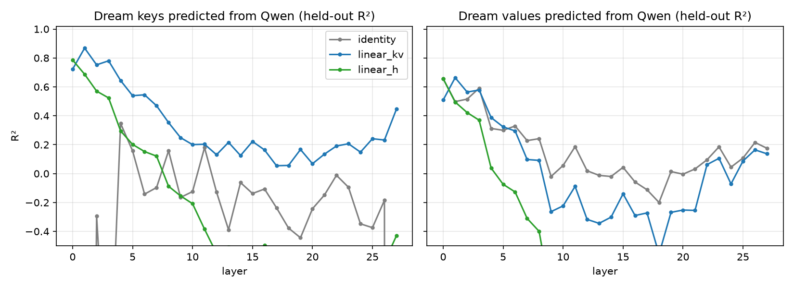

# TwoStory

A homelab [TwoTower](https://arxiv.org/abs/2606.26493): **Dream-7B** (masked-diffusion denoiser) + frozen **Qwen2.5-7B**
(autoregressive context tower), on one Intel Arc Pro B70 (32 GB).

NVIDIA's TwoTower pairs a frozen autoregressive *context tower*, which processes the prompt once into a reusable KV cache, with a
*diffusion denoiser* that refines a block of masked tokens in parallel while attending to that cache. NVIDIA trained its denoiser
on ~2.1T tokens. TwoStory shortcuts that: Dream-7B already denoises and is itself derived from Qwen2.5-7B, so the two towers share a
tokenizer, hidden size, layer count and representation lineage, and only the bridge between them has to be learned.

**Hypothesis:** a lineage-matched bridge recovers a meaningful fraction of TwoTower's benefit (block-parallel generation *with* a
reusable context cache) at homelab cost. Full protocol, gates, and rationale: [docs/PROTOCOL.md](docs/PROTOCOL.md).

## Status

In progress. Phase 5 was paused on 2026-09-20 to pivot to a closed-form linear K/V-map bridge ([docs/TODO.md](docs/TODO.md)).

| Stage | State |
|---|---|
| Phases 0–3: environment, regression, overfit, pilot | Done; every gate PASS ([reports](docs/)) |
| Phase 4: trained cross-attention bridge | Done: 77.8M tokens, 30.8 h on the B70 ([report](docs/PHASE4_REPORT.md)) |
| Phase 5: throughput / quality benchmark | Main sessions complete; Fast-dLLM v2 baseline partial; report not yet written |
| Linear K/V-map bridge | First results in ([report](docs/LINMAP_RESULTS.md)) |

## Results so far

Masked cross-entropy on 32 held-out sequences with identical masks throughout. "Gap closed" runs from Dream with no context (0%)
to plain Dream with the context in its own input (100%).

| Context source fed into Dream | Masked CE | Gap closed |
|---|---|---|
| none (unconditional) | 4.908 | 0% |
| linear K/V map, closed form (zero gradient steps, 10.5 min fit) | 4.051 | 59.5% |
| linear hidden→K/V map, closed form | 3.948 | 66.6% |
| trained cross-attention bridge (Phase 4, 86M tokens incl. pilot) | 3.771 | 79.0%* |
| oracle: Dream's own context K/V, computed once per block | 3.488 | 98.6% |
| plain Dream | 3.468 | 100% |

\* 78.8% in Phase 4's own final evaluation; 79.0% is the same checkpoint re-scored alongside the linear maps.

- **The wiring isn't the bottleneck.** The oracle row shows "context processed once per block, block-only denoiser" reproduces
  Dream almost exactly; what limits quality is how good the context K/V are.
- **A linear map gets most of the way for almost nothing.** Fitted in minutes on 0.2M tokens, it recovers 60–67% of the gap,
  against 79% for 86M tokens of gradient training. It is a far better starting point than a zero-initialised bridge.
- **Dream can be its own context tower.** Caching Dream's own context K/V per block costs almost no quality, which cuts prompt cost
  S-fold with no second model (though without Qwen's prompt-length-independent causal cache).
- **Open problem: exposure bias** (preliminary, Phase 5). In generation, repetition falls from 0.76 at 128-token prompts to 0.09 at
  4096: with short prompts the cache fills with self-generated blocks the bridge never saw in training.



**Requirements:** Linux and an Intel Arc GPU (PyTorch XPU). Scripts assume `.venv/bin/python`; long jobs run under `systemd-run --user`.

## Layout

| Path | What |
|---|---|
| `docs/PROTOCOL.md` | The experimental protocol. Every phase has a go/no-go gate. |
| `docs/PHASE{0,1,2,3,4}_REPORT.md` | Per-phase results and decisions. |
| `docs/BENCHMARK.md`, `docs/LINMAP_RESULTS.md`, `docs/TODO.md` | Phase 5 benchmark protocol, linear K/V-map results, open work. |
| `phase0/` … `phase4/` | One standalone script per checklist item. Each prints `[GATE] ...: PASS/FAIL` and a verdict; `run_all.sh` runs a phase in order. |
| `bench/` | Phase 5 benchmark harness: sessions run one at a time under a stall guard and resume by key; `analyze.py` builds tables and figures from raw logs without touching the GPU. |
| `linmap/` | Closed-form linear K/V-map bridge: fit (ridge regression) and functional test. |
| `twostory/` | `util.py` (loaders, memory, gates, provenance, telemetry), `prompts.py` (frozen prompts), `dream/` (vendored Dream + bridge hooks), `bridge.py`, `context_tower.py`, `model.py` (`TwoStory`: full/block generation, training loss). |
| `reference/` | Unmodified configs, tokenizer files and Dream's remote modeling code, for reading and diffing. |
| `logs/phase0/` | JSON reports and logs from each check. `baseline_A_dream_16bit.json` is the Phase 1 regression target. |
| `data/` | (git-ignored) FineWeb-Edu parquet shards and the pre-tokenized `tokens/{train,heldout}.bin`. |

## Setup

```bash
uv venv --python 3.12 .venv
uv pip install --python .venv/bin/python torch --index-url https://download.pytorch.org/whl/xpu
uv pip install --python .venv/bin/python "transformers==4.57.6" peft bitsandbytes accelerate datasets pyarrow numpy psutil safetensors
uv pip install --python .venv/bin/python -e .
```

bitsandbytes' 8-bit optimizer needs Triton-XPU, which needs the Level Zero headers in user space: see the
"Environment fix" section of `docs/PHASE2_REPORT.md`.

Weights live in the default HF cache (`hf download Dream-org/Dream-v0-Base-7B`, `hf download Qwen/Qwen2.5-7B`);
revisions are pinned in `twostory/util.py`. Data: two `sample/10BT` shards of `HuggingFaceFW/fineweb-edu` under
`data/fineweb-edu/`.

## Running a phase

```bash
phase0/run_all.sh            # everything, in order, stops at the first FAIL
phase1/run_all.sh            # regression (token-identical to Baseline A) + gradient flow + block-mode smoke
.venv/bin/python phase2/20_overfit.py   # overfit one batch; peak VRAM with optimizer state
phase3/watchdog.sh                      # pilot under a progress watchdog (auto-resume), then throughput
.venv/bin/python phase3/32_reference_loss.py   # T0 / T / D masked CE on identical blocks + steps sweep
phase4/start.sh | phase4/stop.sh | .venv/bin/python phase4/status.py   # the run, piecewise
.venv/bin/python phase0/04_baseline_dream.py --bits 8   # or any single check
bench/run_all.sh [sessions...]          # Phase 5 benchmark (default: main q swap gsm gsmq)
.venv/bin/python bench/analyze.py      # Phase 5 tables + figures from logs/phase5/
.venv/bin/python linmap/fit_and_eval.py --fit-seqs 400 --val-seqs 24 --eval-seqs 32   # linear K/V map, ~10 min
```

## Memory plan

Denoiser (Dream) in **bf16**, context tower (Qwen) in **int8** via bitsandbytes' XPU wheel: 22.3 GiB resident;
26.9 GiB peak in training with the full-size bridge (406.6M trainable) and 8-bit AdamW.
int8 on XPU is 4-8x slower than bf16 per linear, so only the tower that runs once per block is quantised.
See the addendum in `docs/PHASE0_REPORT.md`.

## Rules

- No phase starts until the previous gate printed PASS.
- `twostory/prompts.py` and the recorded baselines are frozen after Phase 0.
- The held-out split (`data/tokens/heldout.bin`, hash in `data/tokens/meta.json`) is never trained on.

## License and attribution

TwoStory's own code is released under the [MIT License](LICENSE).

`twostory/dream/` is vendored from [Dream-7B](https://huggingface.co/Dream-org/Dream-v0-Base-7B) (the Dream team, HKUNLP; Apache-2.0),
with `modeling_dream.py` modified to carry the bridge; [docs/dream_modeling.diff](docs/dream_modeling.diff) records every change.
`reference/` holds unmodified upstream files from Dream, [Qwen2.5-7B](https://huggingface.co/Qwen/Qwen2.5-7B) and
[Fast-dLLM v2](https://huggingface.co/Efficient-Large-Model/Fast_dLLM_v2_7B), all Apache-2.0. Details are in [NOTICE](NOTICE), and
the Apache text is in [LICENSES/](LICENSES/Apache-2.0.txt). No model weights are stored in this repository.

The architecture follows NVIDIA's [TwoTower](https://arxiv.org/abs/2606.26493).

Built with AI coding assistance (Claude Code), as [docs/PROTOCOL.md](docs/PROTOCOL.md) describes. The hypothesis, the go/no-go decisions at each gate and the conclusions are mine.
